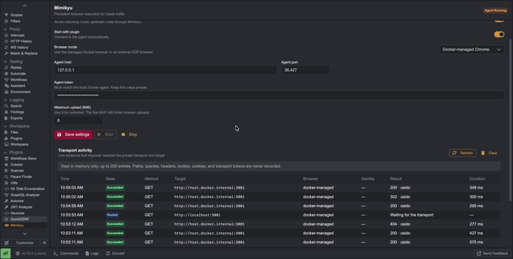

# Mimikyu

<p align="center">
  
</p>

<p align="center"><strong>A persistent browser execution engine for Caido.</strong></p>

Mimikyu is a Caido plugin and local browser agent that executes selected Caido
traffic through a persistent Chrome/Chromium session. It keeps the browser
alive, creates a background target for each request, and closes only that
target when the request finishes.

## Demo

[](docs/PoC.mp4)

## How it works

```text
Caido Proxy / Replay / Automate / Workflows
                    │
                    ▼
             Mimikyu plugin
                    │ authenticated localhost relay
                    ▼
             Mimikyu agent
                    │ persistent CDP connection
                    ▼
        Dockerized Chrome + persistent profile
                    │
                    ▼
              target application
```

The browser is not launched or closed for every request. Mimikyu creates an
isolated background CDP target, executes a navigation, browser `fetch()`, form,
or resource route, captures the response, and releases the target.

## Current status

The current POC supports:

- Caido plugin installation and Upstream Plugin integration;
- persistent Dockerized Chrome with a named profile;
- navigation requests;
- browser `fetch()` requests, including POST and binary bodies;
- basic CORS preflight handling;
- images, scripts, styles, frames, media, manifests, and workers;
- URL-encoded HTML forms;
- multipart bodies and initial response streaming;
- WebSocket echo/relay support;
- request-cookie injection;
- before-request, after-request, and on-start hooks;
- background/hidden targets with concurrency limits;
- CDP reconnect and Docker healthchecks;
- fail-closed behavior when browser routing is unavailable.

Full cancellation semantics, authenticated browser egress pools, and some
advanced multipart/file form controls remain follow-up work.

## Requirements

### Runtime

- Caido with plugin support;
- Docker and Docker Compose;
- a host capable of running the `linux/amd64` Chrome image;
- at least 2 GB of memory available for Chrome;
- a browser window or Xpra-compatible client if manual login is required.

## Install the released Caido plugin

The installable package is published in the [GitHub Releases](https://github.com/incogbyte/mimikyu/releases) page.

1. Download [`plugin_package.zip`](https://github.com/incogbyte/mimikyu/releases/download/v0.1.0/plugin_package.zip).
2. Clone the repository to obtain the Docker browser setup:

   ```sh
   git clone git@github.com:incogbyte/mimikyu.git
   cd mimikyu
   ```

3. Generate a local token and start the agent:

   ```sh
   export MIMIKYU_TOKEN="$(openssl rand -hex 32)"
   docker compose -p mimikyu-poc -f docker-compose.mimikyu.yml up -d
   ```

4. In Caido, install the ZIP through **Plugins → Install Package**.
5. Open **Mimikyu** and set the Docker browser mode, agent host
   `127.0.0.1`, agent port `38427`, and the generated agent token.
6. Enable browser routing and create an Upstream Plugin rule for the domains
   you are authorized to test.

The checksum is available as [`plugin_package.zip.sha256`](https://github.com/incogbyte/mimikyu/releases/download/v0.1.0/plugin_package.zip.sha256).

Verify the local agent with:

```sh
curl http://127.0.0.1:38427/health
```

The expected result is `{"browser":"connected"}`.

## Quick start

From the repository root:

```sh
pnpm install
pnpm build
docker compose -p mimikyu-poc -f docker-compose.mimikyu.yml up -d --build
```

The generated Caido package is:

```text
dist/plugin_package.zip
```

Install it in Caido through:

```text
Plugins → Install Package
```

Then open **Mimikyu** and use these settings:

| Setting | Value |
| --- | --- |
| Browser mode | Docker-managed Chrome |
| Agent host | `127.0.0.1` |
| Agent port | `38427` |
| Agent token | Value of `MIMIKYU_TOKEN` used by the agent |
| Enable browser routing | Enabled |
| Start with plugin | Enabled |

In Caido, create an Upstream Plugin rule under:

```text
Settings → Network → Upstream Plugins
```

Use a narrow allowlist for normal work. `*` is useful only for local testing.

The Dockerized Chrome control panel is available at:

```text
http://127.0.0.1:14111
```

Open this address without routing it through the Caido proxy. The panel is an
Xpra control page; the Chrome profile initially opens on `about:blank`, while
Mimikyu request targets run in the background.

## End-to-end validation

Start the browser agent and local origin:

```sh
docker compose -p mimikyu-poc -f docker-compose.mimikyu.yml up -d
pnpm test:e2e:agent
```

For the full Caido integration, add the Caido service:

```sh
docker compose -p mimikyu-poc \
  -f docker-compose.mimikyu.yml \
  -f docker-compose.caido-poc.yml up -d
pnpm test:e2e:caido
```

The Caido smoke test installs the package, creates an Upstream rule, configures
the external agent, and sends a real proxy request through Caido to the local
origin.

## Configuration and security

The Compose file uses `change-this-development-token` as a local placeholder.
Replace `MIMIKYU_TOKEN` in the Compose environment and enter the same value in
Mimikyu's **Agent token** setting. New plugin settings do not contain a usable
default token.

The agent and Xpra ports are bound to loopback by default. Do not expose the
CDP port publicly. Treat the Chrome profile, cookies, hook files, agent token,
and Xpra endpoint as sensitive.

For the local Xpra/Chrome UI, exclude these addresses from any Caido Upstream
rule that would otherwise route them through Mimikyu:

```text
localhost
127.0.0.1
```

## Useful commands

```sh
pnpm test                 # Typecheck and lint the Caido plugin
pnpm test:agent           # Agent syntax and unit tests
pnpm test:e2e:agent       # Agent + Docker Chrome smoke test
pnpm test:e2e:websocket   # Agent WebSocket smoke test
pnpm test:e2e:caido-websocket # WebSocket through Caido proxy
pnpm test:e2e:caido       # Full Caido package/proxy smoke test
pnpm test:e2e:origin      # Streaming/multipart/WebSocket origin contract
pnpm build                # Build dist/plugin_package.zip
```

## Project layout

```text
packages/backend/       Caido backend, settings, upstream integration, Activity
packages/frontend/      Caido settings and Activity UI
packages/shared/        Shared API and event types
agent/                  Persistent CDP browser agent and localhost relay
docker/chrome/          Persistent Chrome/Xpra image
tests/e2e/              Local protocol origin and agent/Caido smoke tests
```

## License

Mimikyu is distributed under the GNU GPL v3.0. See [`LICENSE`](LICENSE).
